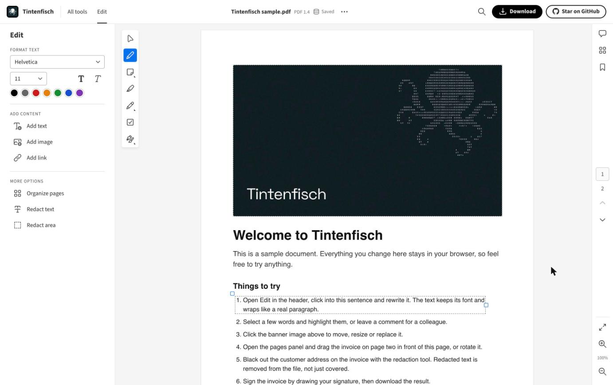
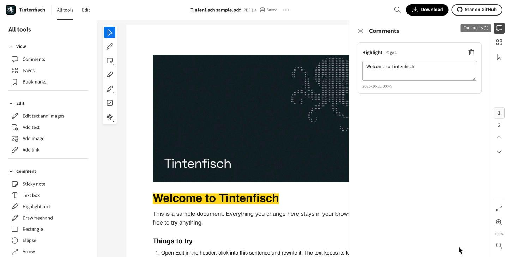
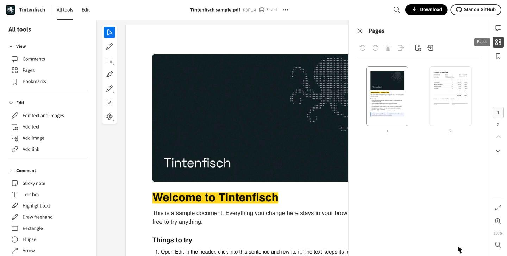

# Tintenfisch

[](https://github.com/ArifKobel/Tintenfisch/actions/workflows/ci.yml)
[](https://github.com/ArifKobel/Tintenfisch/releases)
[](LICENSE)

A PDF editor that runs entirely in your browser. Edit text in place, organize pages, annotate, fill and build forms, redact, sign and protect documents, without uploading a single file.

**[Open Tintenfisch](https://tintenfisch.app)**



## Why Tintenfisch

- **Your files stay on your device.** Documents are opened, edited and saved in the browser. There is no server that sees them, and no account.
- **A real PDF engine.** The engine is written from scratch in Rust and compiled to WebAssembly. It edits the content streams of a page instead of painting over them, so text you change stays text.
- **Free and open.** MIT licensed, no watermarks, no page limits.

## Features

**Edit**
- Change text in place. Paragraphs reflow, and the original font is kept where the file allows it.
- Add new text and images, move, resize and replace existing images.
- Add and edit links.

**Comment**
- Sticky notes, text boxes, highlights, freehand drawing, rectangles, ellipses, arrows and stamps.
- A comments panel to read, edit and delete them.

**Organize**
- Rotate, delete, reorder and extract pages, insert blank pages or pages from another PDF.
- Edit the bookmarks of a document.

**Forms**
- Fill in text fields, checkboxes, radio buttons and lists.
- Create new form fields and change their properties.

**Redact, sign and protect**
- Redact text and areas. Redacted content is removed from the file, not just covered.
- Place a drawn or uploaded signature, or sign digitally with a certificate file (`.p12`, `.pfx`), and check existing signatures.
- Protect a document with a password (AES-256) and restrict printing, copying or editing.

**And more**
- Find text, zoom, print, and download the result.
- Recent files are kept in your browser and saved automatically while you work.

| Comments | Pages |
| --- | --- |
|  |  |

## Privacy

Tintenfisch never uploads your documents. The only outgoing requests are optional font downloads: to type letters a PDF does not carry, Tintenfisch can fetch a matching open font from Fontshare or Fontsource. It asks before it does, and you can change the answer under More options.

## Browser support

Tintenfisch needs a current browser with WebAssembly, Web Workers, OffscreenCanvas and IndexedDB, such as current versions of Chrome, Edge, Firefox and Safari.

## Development

```sh
pnpm install
pnpm dev
```

You need Node.js 24, pnpm and Rust stable with the `wasm32-unknown-unknown` target. [CONTRIBUTING.md](CONTRIBUTING.md) explains the setup, the project layout and the checks a pull request needs.

Link previews point to the address in `VITE_SITE_URL` (`.env`, https://tintenfisch.app by default). Set it in `.env.local` to build for another address.

Engine tests run natively:

```sh
cd engine && cargo test
```

## Docker

`docker-compose.yaml` builds the app and serves it with nginx on port 80 inside the container, without publishing a host port, so a reverse proxy such as Coolify's routes the domain to it. `VITE_SITE_URL` from the environment or `.env` is applied when the container starts, so changing it needs no rebuild.

## Contributing

Contributions are welcome. Read [CONTRIBUTING.md](CONTRIBUTING.md) first, and report security problems privately as described in [SECURITY.md](SECURITY.md).

## License

MIT. The bundled Liberation and Source Sans 3 fonts are under the SIL Open Font License (`public/fonts/LICENSE`). The interface icons come from Spectrum CSS Workflow Icons under the Apache License 2.0 (`public/licenses/spectrum-css-workflow-icons.txt`).
