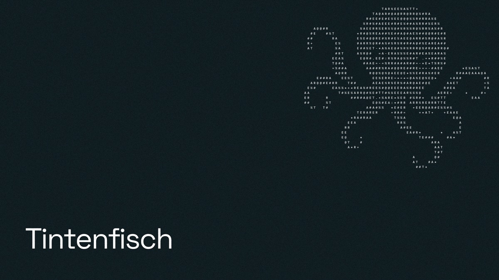

# Tintenfisch

A PDF editor that runs entirely in the browser. Edit text in place, manage pages, annotate, fill and build forms, redact, sign and protect documents.

The PDF engine is written from scratch in Rust and compiled to WebAssembly. The UI is React with TypeScript.

## Development

```sh
pnpm install
pnpm dev
```

Link previews point to the address in `VITE_SITE_URL` (`.env`, https://tintenfisch.app by default). Set it in `.env.local` to build for another address.

Engine tests run natively:

```sh
cd engine && cargo test
```

## License

MIT. The bundled Liberation and Source Sans 3 fonts are under the SIL Open Font License (`public/fonts/LICENSE`). The interface icons come from Spectrum CSS Workflow Icons under the Apache License 2.0 (`public/licenses/spectrum-css-workflow-icons.txt`).
